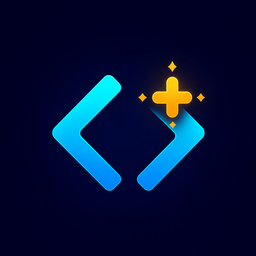

# Codex Extras

[](https://github.com/netroforge/codex-extras/actions/workflows/ci.yml)
[](https://marketplace.visualstudio.com/items?itemName=netroforge.codex-extras)
[](LICENSE)

Small, focused workflow improvements for the official Codex extension in Visual Studio Code.



## Features

### Codex Chats panel

Adds a **Codex Chats** icon to the Activity Bar. Open it to see local Codex
conversations ordered by their most recent activity.

- Chats for the current workspace appear first in an expanded section.
- Chats from other workspaces stay in a separate collapsed section and show
  their workspace name.
- Select a chat to open it as a pinned Codex editor tab.
- Start a new chat or refresh the list from the panel toolbar.
- New and renamed chats appear automatically while VS Code is running.

The panel reads Codex's local session index from `$CODEX_HOME/session_index.jsonl`
when `CODEX_HOME` is set, or from `~/.codex/session_index.jsonl` otherwise.
By default, it reads only the small metadata prefix needed to identify each
chat's workspace; transcript contents are not parsed or copied. The optional
status-icons mode also reads lifecycle events from a bounded log tail (see Settings).

### New Codex Agent toolbar button

Adds a visible code-brackets-and-plus action to the editor toolbar. Select it to
open a new Codex agent. If an empty Codex agent is already open, selecting the
button again opens another empty agent instead of focusing the existing one.

The button is available without assigning a keyboard shortcut.

## Requirements

- Visual Studio Code 1.96.2 or newer
- [Codex – OpenAI's coding agent](https://marketplace.visualstudio.com/items?itemName=openai.chatgpt)

The official Codex extension is declared as a dependency and is installed automatically when Codex Extras is installed from the Marketplace.

## Settings

| Setting | Default | Description |
| --- | --- | --- |
| `codexExtras.showNewAgentButton` | `true` | Shows the New Codex Agent button in the editor toolbar. |
| `codexExtras.showSessionStatusIcons` | `false` | Experimental: replaces conversation icons with live task status and recorded completion events. |

Enable **Codex Extras: Show Session Status Icons** for a spinner while working,
a green check mark for a new result to review, a stop icon for interrupted turns,
or an error icon for failed turns. A yellow question mark means an unanswered
non-blocking question; the agent may still be working. It disappears after all
questions have matching replies. A gray slashed circle means status is unknown.
Sending a new ordinary user message supersedes earlier questions, including
older histories migrated into a single turn;
interrupted or failed turns do not keep abandoned questions active.
A bell means Codex is waiting for input or approval, and a hollow circle means idle.
A clock means activity is unconfirmed, not that the task has completed.
Changing the setting takes effect immediately.

Opening a green chat through Codex Extras marks that specific result as reviewed
after the open command succeeds and its editor tab exists. Its status icon then
disappears, with an empty icon slot preserving text alignment. This is saved in VS Code extension storage across reloads. A later
completed turn gets a new green mark; opening an older result cannot consume it.
Failed opens do not mark results as reviewed. Blocking waits take priority over
non-blocking questions, and unanswered questions take priority over other states.

Status icons use theme-aware colors: blue for working, green for new results,
yellow for questions/waiting, orange for interrupted, red for failed, and muted foreground
for idle or unknown/unconfirmed states. Shapes and tooltip labels also identify
each state, so color is not the only cue.

This optional mode reads at most the last 256 KiB of each local session log and
caches the result. Only explicit lifecycle events determine status; assistant
messages and file modification times do not imply completion. File system events
refresh recorded results without polling. A spinner requires a live `active`
state from Codex's internal local IPC channel; logs alone never produce a spinner.
Losing the connection or receiving an owner-disconnection event invalidates live
status immediately. There is no inactivity timeout for a confirmed running task.

The IPC adapter is experimental and was checked against Codex extension
`26.1007.21434` (stream protocol version 11). An incompatible protocol falls back
to unknown/unconfirmed status. This is an observer only: it does not start,
resume, interrupt, or take ownership of tasks. See [status implementation notes](docs/SESSION-STATUS.md).
When disabled, session bodies are not read, no status watcher is registered,
and no IPC connection is opened.

## Install

Install **Codex Extras** from the Visual Studio Marketplace, or use:

```sh
code --install-extension netroforge.codex-extras
```

For an unpublished development build:

```sh
npm ci
npm run package
code --install-extension codex-extras-1.1.0.vsix
```

## Privacy

Codex Extras contains no telemetry or network requests. It reads the local Codex
session index to populate the chat list and opens editor panels provided by the
official Codex extension. If status icons are enabled, it also reads a bounded
tail of session logs locally to identify lifecycle events and receives local IPC
state snapshots. Only runtime status and unanswered question IDs are retained from snapshots; conversation
messages are discarded and are never displayed, saved, or sent elsewhere.

## Contributing

Contributions and feature proposals are welcome. See [CONTRIBUTING.md](CONTRIBUTING.md).

## Disclaimer

Codex Extras is an independent, unofficial open-source project. It is not affiliated with, endorsed by, or sponsored by OpenAI. Codex, OpenAI, ChatGPT, and related marks are trademarks of their respective owners.

## License

[MIT](LICENSE)
